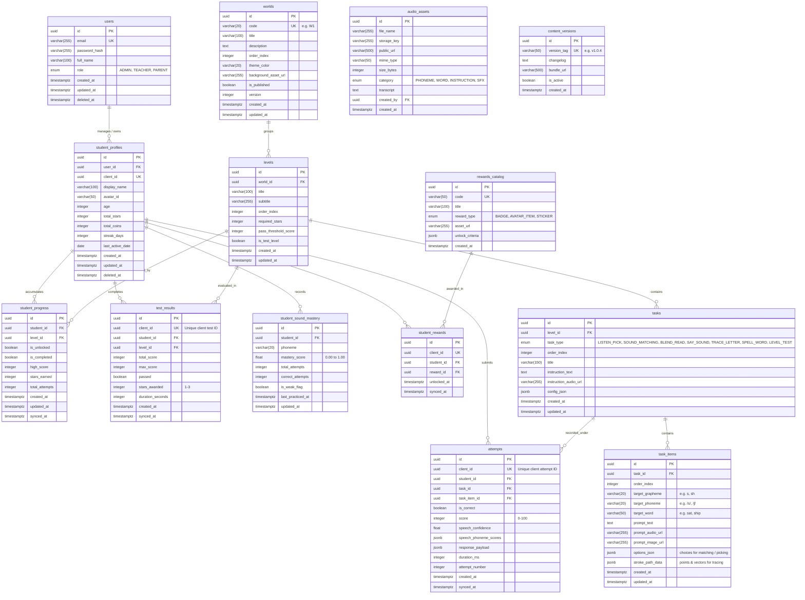

# PhonicsQuest — Database Entity-Relationship Diagram & Schema Specification

This document details the PostgreSQL relational data model for PhonicsQuest, designed for high data integrity, offline synchronization, and educational phonics analytics.

---

## 1. Complete ERD Diagram (Mermaid)

---

## 2. Table Schemas and Indices

### `users`
- Primary authentication entity for parents and teachers.
- Indexed on `email` (unique).

### `student_profiles`
- Multiple learner profiles under a single parent/teacher account.
- Foreign key: `user_id -> users(id) ON DELETE CASCADE`.
- Indexed on `(user_id, deleted_at)`.
- Client identification: `client_id` for local offline account linking.

### `worlds` & `levels` & `tasks` & `task_items`
- Hierarchical curriculum structure.
- Versioning support via `version` column on `worlds` to identify delta updates.
- Cascading relationships: `worlds -> levels -> tasks -> task_items`.

### `attempts`
- Append-only telemetry log.
- Indexed on `(student_id, created_at)` and `(task_id, is_correct)`.
- Enforces `client_id` uniqueness to prevent duplicate ingestion upon repeated sync retries.

### `student_progress`
- Current state for game map progression.
- Unique compound key: `(student_id, level_id)`.
- Indexed on `student_id` for rapid map rendering.

### `student_sound_mastery`
- Aggregated diagnostic record for teacher dashboards and adaptive game difficulty.
- Unique compound key: `(student_id, phoneme)`.
- Auto-updated via trigger or sync service when attempts are processed.
- `is_weak_flag = TRUE` when accuracy drops below 65% across 3+ attempts.

---

## 3. Offline Synchronization Strategy & Conflict Rules

1. **Attempts & Test Results:**
   - Always append-only.
   - Idempotency key = `client_id`. If `client_id` already exists in PostgreSQL, the record is skipped without error and reported as acknowledged.
2. **Student Progress:**
   - **Stars:** `MAX(server.stars_earned, client.stars_earned)`.
   - **High Score:** `MAX(server.high_score, client.high_score)`.
   - **Unlocked Status:** Once unlocked (`is_unlocked = true`), it cannot be locked again.
3. **Student Profile:**
   - Last-Write-Wins (LWW) based on `updated_at` timestamp.
