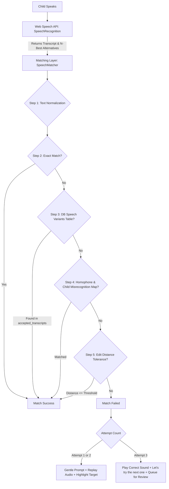
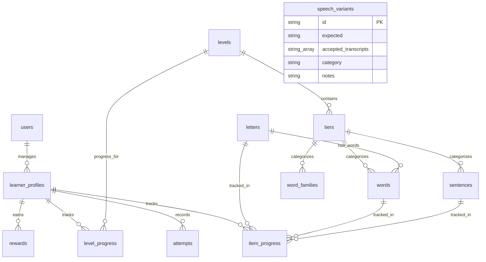

# Phonics Game — Master Architecture & Implementation Plan

**Project:** Phonics Game (Working Name)  
**Version:** 2.0.0 (Voice-Driven Web Architecture)  
**Status:** Under Review (Phase 0)  
**Target Audience:** Beginner students learning to read English aloud via synthetic phonics  
**Monorepo Root:** `/Users/ajc/Phonics Game`  

---

## 1. Executive Summary & Product Vision

**Phonics Game** is a voice-driven, child-friendly English phonics web application (Progressive Web App) designed to teach beginner learners to read aloud. Using speech recognition, the app listens to children articulate letter sounds, blend graphemes into words, and read decodable sentences, providing immediate, joyful, and supportive feedback.

### Core Product Principles
1. **Voice-Only Interaction:** The child's primary input is their voice. There is **NO tracing, NO handwriting, and NO typing**. Touch/tap interactions are reserved exclusively for navigation, speaker replays, and triggering the microphone.
2. **Encouraging, Non-Punitive Pedagogy:** Children never encounter harsh failure sounds, red cross marks, or dead-ends. A 3-attempt cycle provides gentle guidance, model pronunciation replays, and target highlighting. If an item is missed three times, the model sound plays and the item is queued for friendly spaced repetition review later.
3. **Data-Driven & Extensible:** All levels, tiers, letters, word pools, sentences, and speech recognition variants are stored in a relational PostgreSQL database managed via an Admin Panel. Future modules (e.g., writing practice, grammar, tenses) can be added without restructuring the core architecture.
4. **Local-First with Cloud Readiness:** Runs locally for a single learner with Docker Compose (PostgreSQL) and local disk storage, while maintaining clean service abstractions (`SpeechService`, `StorageService`) and standard PostgreSQL schema so the system can transition to Supabase/Hostinger and Cloudflare R2/S3 without code rewrites.
5. **Pure Phonics Text Decoding (No Image Guessing):** Words are displayed as clean, high-contrast text without accompanying pictures or emojis. This prevents children from relying on visual picture guessing and ensures authentic phonological decoding of letters and sounds.
6. **Voice-Only Oral Spelling Test (Alphabet Names, No Phonics Sounds):** Spelling tests are conducted strictly by voice recognition using the **Alphabet Names** (e.g., "Bee - Ee - Dee" or "See - Ay - Tee", not phonics sounds like "buh - eh - duh"). Both on-screen guides and synthesizer model audio state the clean letter names (A = "Ay", B = "Bee", C = "See"...) so students learn to spell without confusion. No typing, handwriting, or letter tiles.
7. **Step-by-Step Previous Step Exit:** Pressing the Exit button always retreats to the immediate previous step (e.g., Stage 2 Voice Spelling -> Stage 1 Read Aloud -> Previous Word), allowing children to review without losing place.
8. **Multi-Step Mastery Scoring (All Steps Completed = +1 Score):** A score point (+1) is counted strictly when all sequential steps for a word are completed (Read Aloud + Blending + Voice Spelling in study mode, or Read Aloud + Voice Spelling in test mode).

---

## 2. Monorepo Architecture & Directory Structure

The project is structured as a TypeScript monorepo with shared packages and modular applications.

```
Phonics Game/
├── pnpm-workspace.yaml         # pnpm workspace definition (packages/*, apps/*)
├── package.json                # Monorepo root configuration
├── docs/                       # Architecture & operational guides
│   ├── PLAN.md                 # This master plan
│   ├── CURRICULUM.md           # Detailed curriculum & pedagogical sound lists
│   ├── AUDIO_NEEDED.md         # Inventory of required pre-recorded audio assets
│   ├── API.md                  # REST API specification & OpenAPI definitions
│   └── GO_LIVE.md              # Production deployment & hosting guide (Supabase/Hostinger)
│
├── apps/
│   ├── web/                    # [Learner PWA] React 18 + Vite + Tailwind CSS + Framer Motion
│   │   ├── public/             # Mascot illustrations, sound effects, PWA manifest, icons
│   │   │   ├── audio/sfx/      # Sound effects (sparkle, chime, pop, gentle encouragement)
│   │   │   └── mascot/         # SVG/WebP mascot emotion states (happy, listening, cheering)
│   │   ├── src/
│   │   │   ├── components/     # UI primitives (BigButton, MicButton, SoundTile, StarMeter)
│   │   │   ├── features/       # Feature modules
│   │   │   │   ├── onboarding/ # Friendly mic permission explanation modal
│   │   │   │   ├── level1/     # Letter Map, Meet the Sound, Say the Sound, Word Parade
│   │   │   │   ├── level2/     # Blend Random Words, Grapheme Tile illumination & merge
│   │   │   │   ├── level3/     # Common Words & Patterns (Sight words, Word Families)
│   │   │   │   ├── level4/     # Sentence Reading with word-by-word highlight & retry
│   │   │   │   ├── speech-lab/ # Hidden diagnostic tool for recognizer inspection
│   │   │   │   └── review/     # Spaced repetition quick review carousel
│   │   │   ├── services/       # SpeechService (Web Speech API) & AudioPlayer
│   │   │   ├── store/          # Zustand state stores (learner, session, audio settings)
│   │   │   └── utils/          # Phoneme matching layer, string normalizers, edit distance
│   │   ├── vite.config.ts      # Vite config with basic-ssl and vite-plugin-pwa
│   │   └── package.json
│   │
│   ├── api/                    # [Backend API] NestJS (Fastify adapter) + Prisma ORM
│   │   ├── prisma/
│   │   │   ├── schema.prisma   # PostgreSQL relational data schema (14 tables)
│   │   │   ├── migrations/     # Standard SQL migrations
│   │   │   └── seed.ts         # Comprehensive child-safe seed data generator
│   │   ├── src/
│   │   │   ├── common/         # Fastify multipart filters, rate limiters, guards
│   │   │   ├── config/         # Environment variables & runtime settings
│   │   │   ├── database/       # Prisma service lifecycle
│   │   │   ├── storage/        # StorageService interface + LocalDiskStorage implementation
│   │   │   ├── modules/
│   │   │   │   ├── auth/       # JWT auth & learner profile switching
│   │   │   │   ├── content/    # Levels, tiers, letters, words, sentences selection
│   │   │   │   ├── progress/   # Attempt tracking, star calculation, review queue
│   │   │   │   ├── admin/      # Content CRUD, batch review, speech variants editor
│   │   │   │   └── settings/   # Dynamic unlock thresholds, strictness, test switches
│   │   │   ├── app.module.ts
│   │   │   └── main.ts         # Fastify bootstrap with Swagger UI at /docs
│   │   └── package.json
│   │
│   └── admin/                  # [Admin Panel] React 18 + Vite + Tailwind CSS
│       ├── src/
│       │   ├── pages/
│       │   │   ├── Dashboard/  # Overall accuracy, weak sounds heatmap, attempt count
│       │   │   ├── Letters/    # Letter manager & sample word link editor
│       │   │   ├── Words/      # Word pool manager, grapheme editor, audio uploader
│       │   │   ├── Sentences/  # Sentence pool manager, token reviewer
│       │   │   ├── Variants/   # Speech recognition variant mapping table editor
│       │   │   └── Settings/   # Pass thresholds, strictness presets, unlock-all switch
│       │   ├── components/     # AudioPreviewButton, AudioUploader, ReviewBadge
│       │   └── services/       # Axios API client for NestJS backend
│       └── package.json
│
└── packages/
    └── shared/                 # Shared TypeScript models, contracts, DTOs & utilities
        ├── src/
        │   ├── types/          # User, Learner, Level, Word, Sentence, Attempt, Speech types
        │   ├── constants/      # 26 Letters, Tier definitions, Default strictness config
        │   ├── matching/       # Pure string normalizer, homophones, phonetic distance
        │   └── index.ts
        └── package.json
```

> **Note on Existing Files:** The folder contains a prior prototype with `apps/mobile` (Expo). To satisfy the requirement of never destroying existing code while establishing the target structure, `apps/mobile` remains preserved, and the new web learner application will be created in `apps/web`.

---

## 3. Technology Stack & Technical Decisions

| Layer | Selected Technology | Architectural Justification |
| :--- | :--- | :--- |
| **Learner App** | **React 18 + Vite + TypeScript** | Extremely fast compile times, zero overhead, ideal for interactive visual web applications. |
| **PWA & Offline** | **`vite-plugin-pwa` (Workbox)** | Offline caching for app shell, icons, level assets, and pre-recorded audio files. Provides installable app experience on tablets and smartphones. |
| **Styling & Theme** | **Tailwind CSS** | Utility-first CSS allowing tailored child-friendly color palettes, accessible contrasts, and responsive viewport sizing. |
| **Motion & FX** | **Framer Motion** | Spring-based physics animations for sound tiles merging, mascot state transitions, star bursts, and celebratory modals. |
| **Client State** | **Zustand** | Lightweight, boilerplate-free state store for session progress, audio preloading, and user settings. |
| **Voice Recognition** | **Web Speech API (`SpeechRecognition`)** | Built into modern Chromium browsers (Chrome, Edge, Android Webview). Abstracted behind a `SpeechService` interface to allow cloud pronunciation providers in the future. |
| **Audio Engine** | **HTML5 Audio / Web Audio API** | Zero-latency playback of pre-recorded human phonemes and words. Strict rule: isolated phonemes are NEVER generated via TTS; browser `speechSynthesis` is strictly a fallback for sentences/words. |
| **Backend API** | **NestJS + Fastify Adapter** | Fastify provides up to 2x higher throughput and lower latency than Express. NestJS provides enterprise modularity, dependency injection, and automatic Swagger docs. |
| **Database & ORM** | **PostgreSQL 16 + Prisma ORM** | Standard SQL database. Dockerized locally; directly portable to Supabase or Hostinger VPS with zero code modification. |
| **File Storage** | **Local Disk behind `StorageService`** | Files stored in `apps/api/uploads/` with public static serving. The `StorageService` interface permits swapping to S3/Cloudflare R2/Supabase Storage without altering controller logic. |
| **Local HTTPS** | **Vite `@vitejs/plugin-basic-ssl`** | Mobile browsers enforce mic permission restrictions (mic only works over `localhost` or valid `https://`). Local HTTPS enables testing on physical phones and tablets over the local Wi-Fi network. |

---

## 4. Voice Recognition & Matching Engine Design (Critical UX)

Voice recognition with young children presents unique phonetic challenges: children articulate sounds with variable pitch, prolonged phonemes, background classroom/home noise, and typical developmental substitutions (e.g., substituting /w/ for /r/, or pronouncing letter names instead of isolated sounds).



### 4.1 SpeechService Interface
The speech engine is encapsulated behind a strict TypeScript contract:

```typescript
export interface SpeechListenOptions {
  timeoutMs?: number;        // Default 6000ms
  lang?: string;             // 'en-US' or 'en-GB'
  strictness?: 'LENIENT' | 'NORMAL' | 'STRICT';
  continuous?: boolean;      // false for isolated words/letters
  interimResults?: boolean;  // true for sentence word-by-word streaming
}

export interface SpeechMatchResult {
  transcript: string;
  alternatives: string[];
  confidence: number;
  matched: boolean;
  score: number;             // 0 to 100
  matchedToken?: string;
  matchedVia?: 'EXACT' | 'VARIANT_TABLE' | 'HOMOPHONE' | 'EDIT_DISTANCE' | 'NONE';
}

export interface ISpeechService {
  listen(expected: string, options?: SpeechListenOptions): Promise<SpeechMatchResult>;
  abort(): void;
  isSupported(): boolean;
}
```

### 4.2 Matching Layer Algorithms (Pure, Unit-Tested)
1. **Normalization:**
   - Strip all leading/trailing whitespace, punctuation (`.`, `,`, `!`, `?`, `-`, `'`), and convert to lowercase.
   - Convert numeric words to digit equivalents or vice-versa (e.g., "to" / "two" / "2").
2. **N-Best Alternatives Evaluation:**
   - Web Speech API yields multiple alternative transcripts. The matcher scans all alternatives in rank order.
3. **Database-Driven Variant Mapping (`speech_variants` table):**
   - For isolated phonemes (Level 1), children often say the letter name or a phonetically ambiguous syllable.
   - Example mappings stored in the DB:
     - Sound `/b/`: `["b", "be", "bee", "bah", "buh"]`
     - Sound `/k/`: `["k", "c", "kay", "cuh", "kuh"]`
     - Sound `/w/`: `["w", "double u", "wuh"]`
     - Sound `/s/`: `["s", "es", "ess", "sss"]`
   - Teachers/admins can add variants directly via the Admin Panel when testing identifies common transcripts.
4. **Child-Voice Leniency & Homophones:**
   - Homophone dictionary: `son/sun`, `sea/see`, `hear/here`, `right/write`, `for/four`, `one/won`.
   - Developmental speech patterns: Accept common consonant substitutions where developmentally appropriate (e.g., /f/ for voiceless /th/ like `fink` for `think`).
5. **Damerau-Levenshtein Edit Distance Tolerance:**
   - Words with length >= 4 characters: allow maximum 1 insertion, deletion, or substitution.
   - Words with length >= 7 characters: allow maximum 2 edits.
   - Strictness level (configured per level and tier) controls whether edit distance is enabled:
     - `LENIENT` (Level 1 and Level 2 Easy): Edit distance enabled + generous variants.
     - `NORMAL` (Level 2 Medium/Advanced, Level 3): Edit distance enabled for >= 5 chars.
     - `STRICT` (Advanced tiers / Testing): Exact and variant table matches only.

### 4.3 3-Attempt Flow (Supportive Feedback)
- **Attempt 1 Miss:**
  - Visual: Friendly mascot animation with a gentle speech bubble: *"Let's try that again!"*
  - Audio: Gentle chime + replay of the model sound.
  - Target letter/word pulses with a warm highlight.
- **Attempt 2 Miss:**
  - Visual: Mascot points to target: *"Listen closely to the sound!"*
  - Audio: Replay model audio at 0.9x speed, emphasizing the articulation.
- **Attempt 3 Miss:**
  - Visual: Mascot smiles warmly: *"Great try! Let's do the next one together."*
  - Audio: Model audio plays once clearly, followed by positive transition chime.
  - Action: The item is marked as requiring review and placed into the learner's `item_progress` queue for subsequent sessions.
  - **Zero Negative Reinforcement:** No buzzers, no red warning colors, no losing lives.

### 4.4 Speech Edge Cases & Privacy
- **Microphone Permission Denied:** Displays a child-friendly, illustrated guidance screen showing a browser address bar with the microphone icon highlighted, offering a large "Tap to Try Again" button.
- **Silence / No Speech (6-Second Timeout):** The listener automatically stops after 6 seconds of silence. Mascot prompts: *"I didn't hear you! Tap the microphone when you're ready to speak."*
- **Unsupported Browsers (e.g., Firefox, iOS non-Safari):** Displays a friendly mascot screen explaining: *"Phonics Game works best in Google Chrome or Microsoft Edge. Please open this page in Chrome to start reading!"*
- **Privacy Onboarding Modal:** Displayed prior to triggering the browser's native permission prompt:
  > **"The app listens to hear you read aloud. Your voice is never recorded or saved."**
- **Speech Lab:** A hidden diagnostic route (`/speech-lab`) accessible via a button in settings or direct URL. It features:
  - Real-time speech recognition status indicator.
  - Target word input box with adjustable strictness toggle.
  - Complete list of alternatives returned by the browser with raw confidence scores.
  - Step-by-step breakdown of which matching rule succeeded or failed.

---

## 5. Curriculum & Level Specifications (Data-Driven)

All levels, tiers, and content in Phonics Game are 100% data-driven and stored in PostgreSQL (`levels`, `tiers`, `letters`, `words`, `word_families`, `sentences`). The old prototype screens (tracing, "The Hissing Snake", "The Cheerful Apple") have been completely replaced with a clean, voice-first learning experience.

```
┌───────────────────────────────────────────────────────────────────────────────────┐
│                              CURRICULUM ARCHITECTURE                              │
├─────────┬──────────────────────────┬──────────────┬───────────────────────────────┤
│ Level   │ Title                    │ Tiers        │ Voice Learning & Test Loop    │
├─────────┼──────────────────────────┼──────────────┼───────────────────────────────┤
│ LEVEL 1 │ Alphabet Sounds & Test   │ Easy/Med/Adv │ Sound Demo -> 10 Word Test    │
│ LEVEL 2 │ Blend Random Words       │ Easy/Med/Adv │ Grapheme Tiles -> Voice Blend │
│ LEVEL 3 │ Common Words & Patterns  │ Easy/Med/Adv │ Sight Words & Word Families   │
│ LEVEL 4 │ Read 3–4 Word Sentences  │ Easy/Med/Adv │ Word-by-Word Streaming Read   │
└─────────┴──────────────────────────┴──────────────┴───────────────────────────────┘
```

---

### 5.1 Level 1: Alphabet Sounds & Test (All 26 Letters — Easy, Medium, Advanced)
- **Primary Milestone:** The student learns the authentic phonetic sound of each alphabet letter and passes a voice recognition test on **10 words** tailored to their chosen difficulty option.
- **3 Difficulty Options (Tiers):**
  - **Easy:** 10 simple 3-letter CVC / beginner decodable words (e.g. for **B**: *bat, bag, bed, bin, box, bug, bus, bun, boy, bow*).
  - **Medium:** 10 medium 4-5 letter words featuring consonant blends and digraphs (e.g. for **B**: *ball, bird, blue, boat, book, boot, bell, bark, barn, bear*).
  - **Advanced:** 10 advanced multi-syllable, vowel team, or richer vocabulary words (e.g. for **B**: *banana, basket, butter, button, balloon, blanket, bridge, beetle, brother, bottle*).
  - **Zero Overlap:** All 30 words per letter across the 3 options are completely distinct ($10 \text{ Easy} + 10 \text{ Medium} + 10 \text{ Advanced} = 30 \text{ distinct words per letter} \times 26 \text{ letters} = 780 \text{ total Level 1 words}$).
- **Interactive Letter Map:**
  - Displays all 26 letters (A–Z) with stars earned per tier.
  - Difficulty toggle pill at the top: **[ Easy ] [ Medium ] [ Advanced ]**. Selecting an option dynamically switches the word set and target test for all 26 letters.
  - Suggests the next recommended letter with a gentle pulsing starlight effect.
- **Step-by-Step Letter Flow:**
  1. **Step (a) Meet the Sound:**
     - Displays the large letter card (e.g., "**Aa**" or "**Bb**").
     - Mascot plays authentic human phoneme audio (e.g., `/æ/` or `/b/`, strictly isolated phoneme sound, NEVER letter-name TTS).
     - Shows the model sample word with an illustration.
  2. **Step (b) Say the Sound:**
     - Child articulates the isolated sound into the mic.
     - Speech recognizer verifies against the `speech_variants` table.
  3. **Step (c) 10-Word Voice Parade:**
     - The 10 distinct words for the selected tier are presented one by one.
     - Each word includes a speaker button to listen to model pronunciation first.
     - The child taps the animated mic button and reads the word aloud.
  4. **Step (d) Letter Voice Test & Celebration:**
     - Quick 10-word voice assessment verifying pronunciation accuracy on the 10 words.
     - Star rewards:
       - **3 Stars:** $\ge 80\%$ first-try accuracy.
       - **2 Stars:** $60\% - 79\%$ first-try accuracy.
       - **1 Star:** Completed session with retries.
     - Confetti animation, mascot cheer, and stars recorded in `level_progress`.

---

### 5.2 Level 2: Blend Random Words (3 Tiers: Easy, Medium, Advanced)
- **Primary Milestone:** Decode printed graphemes into individual sounds and blend them together to read full words.
- **Session Structure:** 8 random words per round drawn from the tier pool.
- **Interactive Sound Tiles (Grapheme Blending):**
  - The word is split into distinct sound tiles (e.g., `c` - `a` - `t` or `sh` - `i` - `p`).
  - Grapheme tiles illuminate sequentially from left to right, each playing its isolated phoneme sound.
  - The student blends the sounds and articulates the complete word aloud into the microphone.
  - **Success Animation:** On recognition match, the tiles smoothly slide together into the unified word with a spring celebration effect.
- **Tiers:**
  - **Easy:** 3-letter CVC words (*cat, sun, bed, dog, pin, hat, map, run*).
  - **Medium:** 4–5 letter words with blends & digraphs (*frog, ship, lamp, stop, fish, clock*).
  - **Advanced:** 6+ letters, 2 syllables, vowel teams (*rabbit, rainbow, chicken, basket, sunset*).

---

### 5.3 Level 3: Common Words & Patterns (3 Tiers: Easy, Medium, Advanced)
- **Primary Milestone:** High-frequency sight words, rhyming word families, and tricky orthographic patterns. Fully data-driven and replaceable.
- **Tiers:**
  - **Easy:** High-frequency sight words (*the, is, you, said, was, are, they, come*).
  - **Medium:** Word families with highlighted rimes (*-at, -ig, -ake, -ight, -op, -ell*).
  - **Advanced:** Tricky spellings & silent letters (*knee, light, would, write, lamb, knock*).

---

### 5.4 Level 4: Read Sentences of 3 to 4 Words (3 Tiers: Easy, Medium, Advanced)
- **Primary Milestone:** Fluency and sentence comprehension. Sentences are strictly kept to 3 to 4 words.
- **Session Pool:** Minimum 60 sentences per tier (180 total sentences), avoiding recent repeats.
- **Interface & Voice Interaction:**
  - Sentence displayed in large phonics typography with a speaker button to listen first.
  - As the student speaks, words highlight in real-time.
  - If a word is missed, only that specific word is highlighted for a retry (partial credit).
- **Tiers:**
  - **Easy:** Common words (*"The cat sat.", "I see a dog.", "The sun is hot."*).
  - **Medium:** Medium blend words (*"The frog can jump.", "We saw the ship."*).
  - **Advanced:** Advanced vocabulary (*"The rabbit hops fast.", "I see the light."*).

---

### 5.5 Progression, Anti-Repetition & Spaced Repetition Rules
- **80% Pass Threshold:** A tier or level unlocks when $\ge 80\%$ of items in the preceding tier/level are completed.
- **"Unlock Everything" Switch:** Available in Settings/Admin for instant access to all levels and tiers.
- **Dynamic Selection (Anti-Repetition):** Randomly selects words/sentences avoiding items encountered in the learner's last 2 sessions.
- **Review Queue:** Items with 3 failed attempts queue automatically into `item_progress` as warm-up items for future sessions.

---

## 6. Child-Friendly UX & Aesthetics System

### 6.1 Visual Design Tokens & Atmosphere
- **Color Palette:** Warm, calming, and cheerful. Avoid high-saturation neon colors that cause eye strain.
  - Primary Background: Soft Cream (`#FFFDF7`) and Warm Cloud (`#F5F8FF`).
  - Brand Primary: Sunny Amber (`#F59E0B`) and Coral Tangerine (`#FB923C`).
  - Brand Secondary: Sky Azure (`#0EA5E9`) and Mint Sage (`#10B981`).
  - Accent / Star: Golden Starlight (`#FBBF24`).
  - Card & Tile Surfaces: Pure White (`#FFFFFF`) with soft drop shadows (`0 8px 24px rgba(0,0,0,0.06)`).
- **Typography:**
  - Phonics-friendly typeface featuring single-story `a` and `g` (e.g., **Andika**, **Lexend Deca**, or **Fredoka**). Standard fonts with double-story characters (`a`, `g`) confuse early phonics readers.
  - Large font scale (letters: 72–120px; words: 48–64px; buttons: 20–24px).
- **Mascot ("Pip the Parrot" / "Ollie the Owl"):**
  - Fully animated companion positioned near instructions.
  - States: `IDLE` (gentle breathing), `TALKING` (mouth moving with audio playback), `LISTENING` (ears perked / leaning in), `CELEBRATING` (jumping with confetti), `ENCOURAGING` (friendly nod).

### 6.2 Prominent Animated Microphone Button
The microphone button is the visual anchor of the reading interface.
- **Size:** 96x96px on mobile; 112x112px on desktop.
- **States:**
  1. `READY`: Bright cyan/green gradient with a subtle expanding pulse ring.
  2. `LISTENING`: Vibrant coral with dynamic soundwave bars animating to incoming audio levels.
  3. `THINKING`: Soft lavender with a smooth rotating sparkle.
  4. `SUCCESS`: Emerald green star burst with haptic feedback (if supported) and instant sound chime within 100ms.
  5. `TRY_AGAIN`: Gentle amber bounce with mascot encouragement.

### 6.3 Performance & Accessibility Standards
- **Initial Load:** Under 3.0 seconds on mid-range Android devices.
- **Route Transitions:** Under 300ms using lightweight Framer Motion transitions.
- **Audio Latency:** Sound effect triggers execute within 100ms of recognition completion.
- **Asset Preloading:** When item $N$ is active, pre-record audio and images for item $N+1$ are preloaded into browser memory.
- **Accessibility:** Minimum contrast ratio 4.5:1 (WCAG AA) and 7:1 for headers. Sound mute toggles, reduced-motion setting (disables spring loops), and oversized touch targets (minimum 56x56px).

---

## 7. Relational Database Schema (Prisma / PostgreSQL)

The database consists of 14 interconnected tables supporting the complete learning journey, audio storage, and speech variants:



### Table Definitions

1. **`users`**
   - `id`: UUID (Primary Key)
   - `email`: String (Unique)
   - `password_hash`: String
   - `role`: Enum (`ADMIN`, `LEARNER`)
   - `created_at`, `updated_at`: DateTime
2. **`learner_profiles`**
   - `id`: UUID (Primary Key)
   - `user_id`: UUID (Foreign Key -> `users.id`)
   - `display_name`: String
   - `avatar_id`: String (e.g., `mascot_parrot`, `mascot_lion`)
   - `total_stars`: Int (default 0)
   - `current_streak`: Int (default 1)
   - `last_active_at`: DateTime
   - `created_at`, `updated_at`: DateTime
3. **`levels`**
   - `id`: UUID (Primary Key)
   - `code`: String (Unique, e.g., `LEVEL_1_SOUNDS`, `LEVEL_2_BLENDS`, `LEVEL_3_PATTERNS`, `LEVEL_4_SENTENCES`)
   - `title`: String
   - `description`: String
   - `order_index`: Int
   - `pass_threshold`: Float (default 0.80)
   - `icon_name`: String
   - `is_active`: Boolean (default true)
4. **`tiers`**
   - `id`: UUID (Primary Key)
   - `level_id`: UUID (Foreign Key -> `levels.id`)
   - `name`: Enum (`EASY`, `MEDIUM`, `ADVANCED`)
   - `description`: String
   - `order_index`: Int
   - `pass_threshold`: Float (default 0.80)
5. **`letters`**
   - `id`: UUID (Primary Key)
   - `character`: String (Unique, 1 char 'a'-'z')
   - `display_label`: String (e.g., "Aa")
   - `phoneme_sound_url`: String (path to pre-recorded letter audio)
   - `sample_word`: String (e.g., "apple", "sun")
   - `sample_image_url`: String (path to illustration)
   - `order_index`: Int (1 to 26)
   - `is_active`: Boolean (default true)
6. **`words`**
   - `id`: UUID (Primary Key)
   - `word`: String
   - `letter_id`: UUID (Nullable, Foreign Key -> `letters.id` for Level 1 pools)
   - `tier_id`: UUID (Nullable, Foreign Key -> `tiers.id` for Level 2/3 pools)
   - `graphemes`: String[] (e.g., `["c", "a", "t"]`, `["sh", "i", "p"]`)
   - `syllables`: String[] (e.g., `["rab", "bit"]`)
   - `audio_url`: String (pre-recorded pronunciation)
   - `image_url`: String (optional visual illustration)
   - `is_active`: Boolean (default true)
   - `reviewed`: Boolean (default false)
7. **`word_families`**
   - `id`: UUID (Primary Key)
   - `name`: String (e.g., "-at", "-ig", "-ake", "-ight")
   - `tier_id`: UUID (Foreign Key -> `tiers.id`)
   - `rime`: String (e.g., "at")
   - `sample_words`: String[] (e.g., `["cat", "hat", "bat", "mat"]`)
8. **`sentences`**
   - `id`: UUID (Primary Key)
   - `text`: String (e.g., "The cat sat.")
   - `tokens`: String[] (e.g., `["the", "cat", "sat"]`)
   - `tier_id`: UUID (Foreign Key -> `tiers.id`)
   - `audio_url`: String (pre-recorded model reading)
   - `is_active`: Boolean (default true)
   - `reviewed`: Boolean (default false)
9. **`speech_variants`**
   - `id`: UUID (Primary Key)
   - `expected`: String (e.g., "b", "c", "fox", "knee")
   - `accepted_transcripts`: String[] (e.g., `["b", "be", "bee", "bah"]`)
   - `category`: String (e.g., "LETTER_SOUND", "HOMOPHONE", "CHILD_MISRECOGNITION")
   - `notes`: String
   - `created_at`, `updated_at`: DateTime
10. **`attempts`**
    - `id`: UUID (Primary Key)
    - `learner_id`: UUID (Foreign Key -> `learner_profiles.id`)
    - `item_type`: Enum (`LETTER`, `WORD`, `SENTENCE`)
    - `item_id`: UUID
    - `attempt_number`: Int (1, 2, or 3)
    - `transcript`: String
    - `alternatives`: String[]
    - `confidence`: Float
    - `matched`: Boolean
    - `duration_ms`: Int
    - `created_at`: DateTime
11. **`item_progress`**
    - `id`: UUID (Primary Key)
    - `learner_id`: UUID (Foreign Key -> `learner_profiles.id`)
    - `item_type`: Enum (`LETTER`, `WORD`, `SENTENCE`)
    - `item_id`: UUID
    - `consecutive_correct`: Int (default 0)
    - `total_attempts`: Int (default 0)
    - `failed_count`: Int (default 0)
    - `needs_review`: Boolean (default false)
    - `last_attempt_at`: DateTime
12. **`level_progress`**
    - `id`: UUID (Primary Key)
    - `learner_id`: UUID (Foreign Key -> `learner_profiles.id`)
    - `level_id`: UUID (Foreign Key -> `levels.id`)
    - `tier_id`: UUID (Nullable, Foreign Key -> `tiers.id`)
    - `completed_items`: Int (default 0)
    - `total_items`: Int (default 0)
    - `stars_earned`: Int (0 to 3)
    - `is_unlocked`: Boolean (default false)
    - `is_completed`: Boolean (default false)
    - `completed_at`: DateTime (Nullable)
13. **`rewards`**
    - `id`: UUID (Primary Key)
    - `learner_id`: UUID (Foreign Key -> `learner_profiles.id`)
    - `reward_type`: Enum (`BADGE`, `STICKER`, `STREAK_MILESTONE`)
    - `reward_key`: String
    - `unlocked_at`: DateTime
14. **`settings`**
    - `id`: UUID (Primary Key)
    - `key`: String (Unique, e.g., `UNLOCK_THRESHOLD`, `GLOBAL_STRICTNESS`, `UNLOCK_ALL_OVERRIDE`)
    - `value`: JSON (e.g., `{"threshold": 0.8}`, `{"strictness": "LENIENT"}`, `{"unlockAll": false}`)
    - `updated_at`: DateTime

---

## 8. Seed Content Strategy & Audio Inventory

### 8.1 Seed Content Generation
- **Level 1 (Sounds):** All 26 letters with sample words, graphemes, and initial word pools of at least 30 medium-difficulty words per letter (at least 15 for Q, X, Z).
- **Level 2 (Blending):**
  - Easy: 40+ 3-letter CVC words with grapheme sound tiles.
  - Medium: 40+ 4-5 letter blend and digraph words.
  - Advanced: 40+ 6+ letter 2-syllable & vowel team words.
- **Level 3 (Patterns):** High-frequency sight words, word families (-at, -ig, -ake, -ight), and tricky spelling words.
- **Level 4 (Sentences):** 60 sentences per tier (Easy: 60, Medium: 60, Advanced: 60 = 180 total sentences).
- **Review Status:** All seed content is automatically inserted with `reviewed = false` so the administrator can inspect, test, and approve entries in the Admin Panel.
- **Language Dialect Decision:** Confirmed: **US English (`en-US`)** standard (e.g., *color*, *favorite*, *gray*, *center*). SpeechRecognition default locale will be set to `en-US`.

### 8.2 Audio Inventory (`docs/AUDIO_NEEDED.md`)
The system will generate `docs/AUDIO_NEEDED.md` detailing every pre-recorded audio file required:
- 26 Letter Phoneme Clips: `audio/phonemes/sound_a.mp3` through `audio/phonemes/sound_z.mp3`.
- 26 Sample Word Audio Clips: `audio/words/apple.mp3`, `audio/words/bear.mp3`, etc.
- Sound Effects: `sparkle.mp3`, `chime_success.mp3`, `try_again.mp3`, `star_fanfare.mp3`.
- Model Word Clips: Audio files for Level 2 and Level 3 words.
- Model Sentence Clips: Audio recordings for Level 4 sentences.

---

## 9. Backend REST API Specification (NestJS + Fastify)

The backend provides a high-performance REST API with Fastify and automatic Swagger UI documentation at `/docs`.

### Key Endpoints

| Method | Endpoint | Auth | Purpose |
| :--- | :--- | :--- | :--- |
| `POST` | `/api/v1/auth/register` | Public | Register user account |
| `POST` | `/api/v1/auth/login` | Public | Authenticate user & return JWT |
| `GET` | `/api/v1/learner/profile` | Bearer | Get active learner profile details |
| `GET` | `/api/v1/content/levels` | Bearer | Get all 4 levels, tiers, and learner unlock status |
| `GET` | `/api/v1/content/letters` | Bearer | Get 26 letters with star scores and suggested next letter |
| `GET` | `/api/v1/content/letters/:char/session` | Bearer | Get 10 random words for letter (anti-repetition algorithm) |
| `GET` | `/api/v1/content/levels/:levelId/tiers/:tierId/words` | Bearer | Get 8 random blend words for Level 2/3 session |
| `GET` | `/api/v1/content/levels/4/tiers/:tierId/sentences` | Bearer | Get 5 random sentences for Level 4 session |
| `POST` | `/api/v1/progress/attempts` | Bearer | Submit attempt result, update streaks, award stars |
| `GET` | `/api/v1/progress/review-queue` | Bearer | Fetch items queued for spaced repetition review |
| `GET` | `/api/v1/admin/variants` | Admin | Get list of speech recognition variants |
| `POST` | `/api/v1/admin/variants` | Admin | Add or update accepted transcripts for a sound/word |
| `POST` | `/api/v1/admin/audio/upload` | Admin | Upload or replace pre-recorded audio file |
| `PATCH` | `/api/v1/admin/content/batch-review` | Admin | Mark verified words/sentences as reviewed |
| `GET` | `/api/v1/settings` | Public | Get public client settings (unlock thresholds, strictness) |
| `PATCH` | `/api/v1/settings` | Admin | Update system configuration or toggle "Unlock Everything" |

---

## 10. Admin Panel Design & Workflows (React 18 + Vite)

The Admin Panel (`apps/admin`) is designed for non-technical educators and content administrators.

### Core Screens & Features
1. **Curriculum Review Dashboard:**
   - Visual counter of unreviewed words, sentences, and missing audio assets.
   - Quick "One-Click Review" button with inline audio preview.
2. **Speech Variants Tuning Console:**
   - Searchable table of expected sounds/words and their recognized transcripts.
   - Form to add new variant transcript strings observed during child testing.
3. **Audio Asset Manager:**
   - Drag-and-drop audio uploader validating file format (`.mp3`, `.ogg`, `.webm`, `.wav`).
   - Built-in audio waveform player to verify clarity of pronunciation.
4. **Learner Analytics:**
   - Sound accuracy breakdown across all 26 phonemes.
   - "Tricky Sounds" heatmap indicating which letters have the highest retry rates.
5. **System Settings:**
   - Sliders for unlock thresholds (default 80%).
   - Dropdown for voice matching strictness (`LENIENT`, `NORMAL`, `STRICT`).
   - Toggle switch for "Unlock Everything" test mode.

---

## 11. Step-by-Step Implementation Phases

```
┌─────────────────────────────────────────────────────────────┐
│ Phase 0: Master Plan & Architectural Review (docs/PLAN.md)  │ ◄ Current Phase
└──────────────────────────────┬──────────────────────────────┘
                               │ Wait for User Approval
                               ▼
┌─────────────────────────────────────────────────────────────┐
│ Phase 1: Monorepo Setup, Docker Compose, Schema, Seeds, API │
│          - pnpm workspaces configuration (pnpm-workspace)   │
│          - Docker Compose (PostgreSQL 16)                   │
│          - Prisma schema (14 tables) & migrations           │
│          - Seed script with US English (en-US) dialect      │
│          - NestJS Fastify API with JWT auth & Content routes│
└──────────────────────────────┬──────────────────────────────┘
                               │ User Checkpoint
                               ▼
┌─────────────────────────────────────────────────────────────┐
│ Phase 2: Web App Shell, Design System, Mascot, Level 1      │
│          - React 18 + Vite + Tailwind + Framer Motion setup │
│          - Child-friendly design tokens & single-story font │
│          - Mascot animated component & audio player engine  │
│          - SpeechService & Speech Lab diagnostic page       │
│          - Level 1: Letter Map, Sound Intro, Word Parade    │
└──────────────────────────────┬──────────────────────────────┘
                               │ User Checkpoint
                               ▼
┌─────────────────────────────────────────────────────────────┐
│ Phase 3: Level 2 (Blend Random Words - All Tiers)           │
│          - Grapheme sound tile component                    │
│          - Sequential tile lighting & phoneme audio sync    │
│          - Whole-word voice blend recognition               │
│          - Spring sliding merge animation on success        │
│          - Tiers: Easy (CVC), Medium (Blends), Adv (Teams)  │
└──────────────────────────────┬──────────────────────────────┘
                               │ User Checkpoint
                               ▼
┌─────────────────────────────────────────────────────────────┐
│ Phase 4: Level 3 & Level 4, Review Queue, Rewards           │
│          - Level 3: Sight words, word families, tricky spell│
│          - Level 4: 3-4 word sentences with word highlight  │
│          - Partial credit retry on missed words             │
│          - Spaced repetition review queue carousel          │
│          - Star awards, streaks, and sticker book           │
└──────────────────────────────┬──────────────────────────────┘
                               │ User Checkpoint
                               ▼
┌─────────────────────────────────────────────────────────────┐
│ Phase 5: Admin Panel Application                            │
│          - React 18 + Vite admin dashboard                  │
│          - Content CRUD (Letters, Words, Sentences)         │
│          - Speech Variants editor & audio uploader          │
│          - Sound accuracy heatmap & system settings         │
└──────────────────────────────┬──────────────────────────────┘
                               │ User Checkpoint
                               ▼
┌─────────────────────────────────────────────────────────────┐
│ Phase 6: PWA Offline Polish, Local HTTPS, Tests & GO_LIVE.md│
│          - Service worker offline asset caching             │
│          - Local HTTPS dev configuration for mobile testing │
│          - Unit tests for speech matcher & anti-repetition  │
│          - Performance audit & docs/GO_LIVE.md guide        │
└─────────────────────────────────────────────────────────────┘
```

---

## 12. Verification & Quality Assurance Plan

### Automated Testing
- **Speech Matcher Unit Tests:** Over 50 sample transcripts testing exact match, variant expansion, homophones, and edit distance thresholds under all strictness modes.
- **Curriculum Anti-Repetition Tests:** Simulation of 10 consecutive sessions verifying that no word repeats across two adjacent sessions.
- **Progression Logic Tests:** Verifying 80% threshold calculation, star rewards, and "Unlock Everything" override switch.

### Manual & UX Testing
- **Microphone Usability on Mobile Devices:** Testing speech input over local HTTPS on Android Chrome and iOS Safari.
- **3-Attempt Flow Validation:** Verifying gentle encouragement, audio replays, and absence of harsh negative feedback.
- **Offline Shell Verification:** Disconnecting network to verify that cached levels, UI assets, and pre-recorded audio remain playable.
