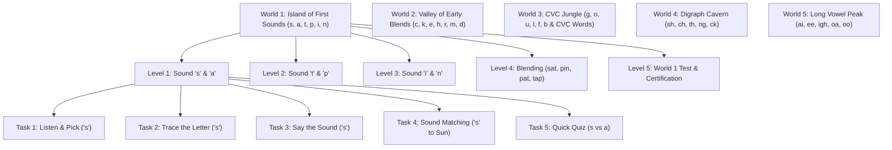
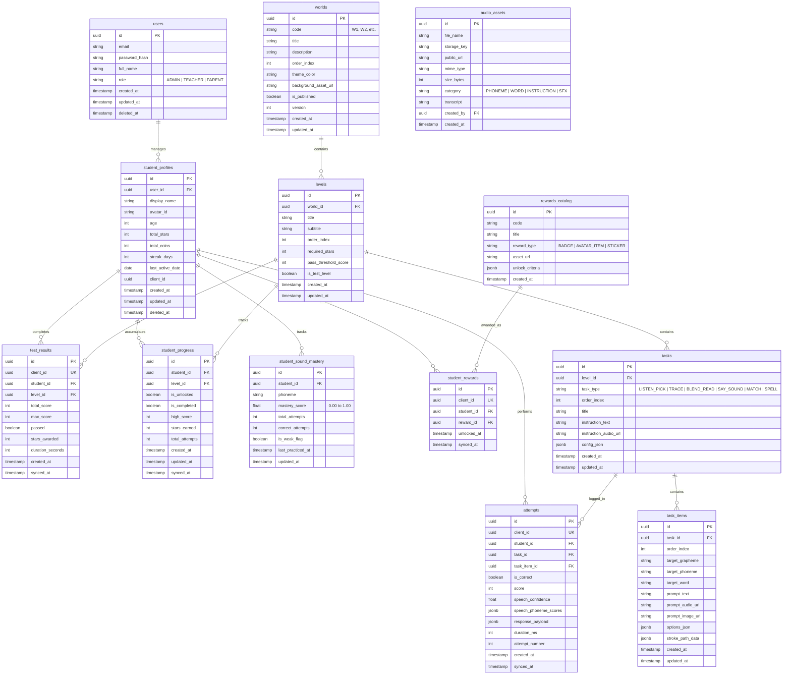
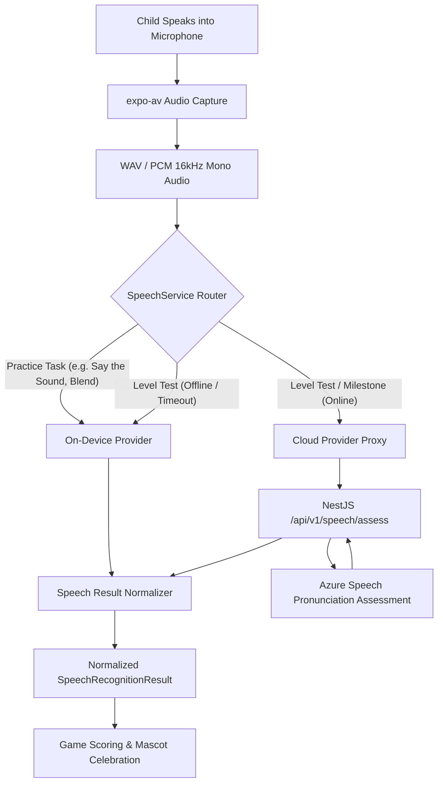

# PhonicsQuest — Master Architecture & Implementation Plan
**Version:** 1.0.0  
**Status:** Under Review (Phase 0)  
**Author:** Senior Full-Stack & Game Development Lead  
**Monorepo Root:** `/Users/ajc/Phonics Game`

---

## 1. Executive Summary & Product Vision

**PhonicsQuest** is a gamified, offline-first mobile phonics learning platform built for young learners (ages 5–8 / Kindergarten to Grade 2) and managed by teachers and parents. The application guides children along an adventure map where they master foundational phonics sounds (synthetic phonics: letter-sound correspondence, blending, segmenting, reading aloud, and tactile letter tracing).

### Core Gameplay Loop
```
   ┌────────────────────────────────────────────────────────┐
   │                       World Map                        │
   │           (Theme: Sound Safari / Island Hop)           │
   └──────────────────────────┬─────────────────────────────┘
                              │ Select Unlocked Level
                              ▼
   ┌────────────────────────────────────────────────────────┐
   │                Daily Phonics Quest Level               │
   │               (5-8 Short Engaging Tasks)               │
   │                                                        │
   │  1. Listen & Pick   ──>  2. Sound Matching             │
   │  3. Trace Letter    ──>  4. Blend & Read (Speech)      │
   │  5. Say the Sound   ──>  6. Spell the Word             │
   └──────────────────────────┬─────────────────────────────┘
                              │ Complete & Pass Threshold
                              ▼
   ┌────────────────────────────────────────────────────────┐
   │                   Level Assessment                     │
   │           (Scored Test: 1-3 Stars + Coins)             │
   └──────────────────────────┬─────────────────────────────┘
                              │ Unlock Rewards & Update Map
                              ▼
   ┌────────────────────────────────────────────────────────┐
   │            Mascot Celebration & Rewards Screen         │
   │        (Pet Evolution, Stickers, Sound Mastery)        │
   └────────────────────────────────────────────────────────┘
```

### Key Differentiators
1. **Hybrid Speech Recognition Engine:** Instant on-device feedback for practice, switching seamlessly to Azure Cloud Pronunciation Assessment for scored evaluations, with offline fallback.
2. **Tactile Tracing with Skia:** High-precision finger tracing that tracks stroke direction, bounding tolerances, and stroke continuity.
3. **True Offline-First Architecture:** Complete lesson packs and assets cache locally via SQLite and MMKV; player progress queues offline and synchronizes idempotently when network connectivity resumes.
4. **Data-Driven Dynamic Content:** Worlds, levels, and tasks are defined as versioned JSON packages managed via an administrative web panel.

---

## 2. Monorepo Architecture & Folder Structure

The project uses a monorepo workspace structure (supporting `npm` or `pnpm` workspaces) sharing common TypeScript types, validation schemas, and constants.

```
Phonics Game/
├── .github/
│   └── workflows/              # CI/CD pipelines (lint, test, build)
├── apps/
│   ├── mobile/                 # React Native + Expo App
│   │   ├── app/                # Expo Router file-based routes
│   │   │   ├── _layout.tsx     # Root provider layout (theme, audio, auth)
│   │   │   ├── (auth)/         # Parent/Student profile selection
│   │   │   ├── (game)/         # Game loop routes
│   │   │   │   ├── map.tsx     # World & level selection map
│   │   │   │   ├── level/[id].tsx # Level task runner
│   │   │   │   ├── test/[id].tsx  # Level test runner
│   │   │   │   └── rewards.tsx # Level complete & star awards
│   │   │   ├── (debug)/        # Speech Lab & Audio tester
│   │   │   │   └── speech-lab.tsx
│   │   │   └── (settings)/     # Parent gate & app settings
│   │   ├── assets/             # Bundled offline audio, fonts, mascot SVGs
│   │   │   ├── audio/          # Sound effects (chimes, clicks, mascot cheers)
│   │   │   ├── fonts/          # Fredoka, Nunito, Comic Neue
│   │   │   └── mascot/         # Lottie & SVG character assets
│   │   ├── src/
│   │   │   ├── components/     # UI primitives (Buttons, Stars, Cards, Modals)
│   │   │   ├── features/       # Game activities
│   │   │   │   ├── listen-pick/
│   │   │   │   ├── sound-matching/
│   │   │   │   ├── blend-read/
│   │   │   │   ├── say-sound/
│   │   │   │   ├── trace-letter/
│   │   │   │   ├── spell-word/
│   │   │   │   └── level-test/
│   │   │   ├── services/       # Speech, Audio, Sync, Storage
│   │   │   │   ├── speech/     # Hybrid SpeechService implementation
│   │   │   │   │   ├── SpeechService.ts
│   │   │   │   │   ├── OnDeviceSpeechProvider.ts
│   │   │   │   │   ├── CloudSpeechProvider.ts
│   │   │   │   │   └── speech.types.ts
│   │   │   │   ├── audio/      # expo-av sound player & mic recorder
│   │   │   │   ├── db/         # expo-sqlite migrations & queries
│   │   │   │   └── sync/       # Background sync queue & delta resolver
│   │   │   ├── store/          # Zustand state stores (game, profile, sync)
│   │   │   ├── theme/          # Child-friendly color tokens, typography
│   │   │   └── utils/          # Geometry for tracing, phoneme normalizer
│   │   ├── package.json
│   │   ├── app.json            # Expo config
│   │   └── tsconfig.json
│   │
│   ├── api/                    # NestJS Backend API
│   │   ├── src/
│   │   │   ├── common/         # Guards, interceptors, filters, decorators
│   │   │   ├── config/         # Environment & database configs
│   │   │   ├── database/       # Prisma service & client
│   │   │   ├── modules/
│   │   │   │   ├── auth/       # JWT auth, user/teacher registration
│   │   │   │   ├── students/   # Student profile & progress management
│   │   │   │   ├── content/    # Worlds, levels, tasks, content packs
│   │   │   │   ├── speech/     # Azure Pronunciation Assessment proxy
│   │   │   │   ├── sync/       # Delta sync engine (push attempts, pull diffs)
│   │   │   │   ├── assets/     # S3 / Cloudflare R2 audio & image storage
│   │   │   │   └── admin/      # Teacher analytics & curriculum editor
│   │   │   ├── app.module.ts
│   │   │   └── main.ts         # Swagger & bootstrap
│   │   ├── prisma/
│   │   │   ├── schema.prisma   # PostgreSQL schema & relations
│   │   │   ├── migrations/
│   │   │   └── seed.ts         # Initial phonics curriculum seed data
│   │   ├── package.json
│   │   └── tsconfig.json
│   │
│   └── admin/                  # React Web Management Panel (Vite)
│       ├── src/
│       │   ├── components/     # Layout, Nav, AudioPlayer, Tables, Modal
│       │   ├── pages/
│       │   │   ├── Dashboard/  # Overall student performance stats
│       │   │   ├── Curriculum/ # Worlds, Levels, Tasks builder
│       │   │   ├── Assets/     # Audio library & upload manager
│       │   │   └── Students/   # Sound mastery matrix & weak sound heatmaps
│       │   ├── services/       # Axios API client
│       │   ├── App.tsx
│       │   └── main.tsx
│       ├── package.json
│       └── vite.config.ts
│
├── packages/
│   └── shared/                 # Shared TypeScript models, enums & utilities
│       ├── src/
│       │   ├── types/
│       │   │   ├── user.types.ts
│       │   │   ├── content.types.ts
│       │   │   ├── activity.types.ts
│       │   │   ├── speech.types.ts
│       │   │   └── sync.types.ts
│       │   ├── constants/
│       │   │   ├── phonics-curriculum.ts # Phonics progression stages
│       │   │   └── activity-rules.ts    # Default timeouts, scoring rules
│       │   ├── schemas/        # Zod validation schemas
│       │   └── index.ts
│       ├── package.json
│       └── tsconfig.json
│
├── docs/                       # Architecture documentation
│   ├── PLAN.md                 # Master Implementation Plan
│   ├── ERD.md                  # Detailed Database Entity-Relationship Diagram
│   ├── API.md                  # REST API Specification (OpenAPI compliant)
│   └── SPEECH_ENGINE.md        # Hybrid Speech Recognition Architecture
│
├── .gitignore
├── .prettierrc
├── .eslintrc.js
├── turbo.json                  # Turborepo task pipeline (build, test, lint)
└── package.json                # Monorepo root workspace configuration
```

---

## 3. Technology Stack Justification

| Layer | Technology | Rationale & Selection Criteria |
| :--- | :--- | :--- |
| **Mobile Runtime** | **React Native + Expo (SDK 51+)** | Cross-platform (Android primary target, iOS fully supported). Expo provides fast development, native audio (`expo-av`), SQLite, and seamless asset updates. |
| **Mobile Navigation** | **Expo Router v3** | Type-safe, deep-linkable, file-based routing optimal for clean navigation between map, activities, tests, and settings. |
| **Mobile State** | **Zustand + MMKV** | Lightweight, boilerplate-free state management. MMKV handles sub-millisecond local key-value storage (settings, tokens, active profile). |
| **Mobile Local DB** | **expo-sqlite** | Robust relational database for caching content packs, storing queued offline attempts, and maintaining student progress without connectivity. |
| **Tracing Engine** | **@shopify/react-native-skia** + Gesture Handler | Hardware-accelerated 2D canvas enabling smooth finger tracing paths, stroke smoothing (Catmull-Rom splines), and path similarity matching. |
| **Mobile Animations**| **react-native-reanimated** + Lottie | High-performance 60fps animations for celebrations, mascot reactions, star popups, and progress bars. |
| **Backend Framework**| **NestJS (Node.js + TypeScript)** | Enterprise modular architecture, built-in dependency injection, native validation pipes, Swagger integration, and scalable REST API patterns. |
| **Database & ORM** | **PostgreSQL + Prisma ORM** | ACID-compliant relational storage for nested curriculum hierarchies, student attempts, and complex progress analytics. Prisma delivers end-to-end type safety. |
| **Asset Storage** | **Cloudflare R2 / AWS S3** | High-throughput, cost-effective CDN-backed object storage for phoneme audio clips, word pronunciations, and visual assets. |
| **Admin Web App** | **React (Vite + TypeScript)** | Fast, modern web interface for teachers and administrators with interactive sound preview and student analytics heatmaps. |

---

## 4. Phonics Curriculum Structure & Progression

The curriculum is structured into **Worlds** (Phonics Stages), **Levels** (Sound Sets), and **Tasks** (Activities), following established synthetic phonics methodologies (e.g., Jolly Phonics / Letters and Sounds).



### Activity Types Detailed Specification
1. **Listen & Pick:** Student hears audio prompt (e.g., `/s/`), selects among 2–4 animated letter/picture tiles. Immediate mascot praise or gentle retry.
2. **Sound Matching:** Interactive drag-and-drop or pair matching between grapheme tiles (`s`, `m`, `t`) and picture/sound cards.
3. **Blend & Read:** Visual phoneme buttons illuminate in sequence (`/s/` ... `/æ/` ... `/t/`), then slide together to form `sat`. Student blends and reads into the microphone.
4. **Say the Sound:** Letter or digraph displayed prominently with visual mnemonic. Student articulates the sound into the microphone.
5. **Trace the Letter:** Skia-driven canvas presents stroke order dots with animated directional arrows. Student traces with finger. Precision evaluated using path Hausdorff/Fréchet distance metrics.
6. **Spell the Word:** Student hears target word (e.g., "cat"), presented with blank letter slots and scrambled letter bubbles to tap/drag into place.
7. **Level Test:** Evaluative composite assessment (5–10 mixed questions) calculating pass/fail, star rating (1–3 stars), coin rewards, and phoneme mastery score.

---

## 5. PostgreSQL Database Schema & ERD

### Database Architecture Principles
- **Idempotent Sync:** Every mutable and append-only record generated on mobile contains a `client_id` (UUIDv4) and `synced_at` timestamp to guarantee zero duplicates during offline reconciliation.
- **Auditing & Timestamps:** `created_at` and `updated_at` on all tables, with soft deletion (`deleted_at`) to preserve historical attempts.
- **Content Versioning:** The `content_versions` table tracks published curriculum bundles. Mobile clients check `version` on startup and download delta JSON packs.

### Entity-Relationship Diagram (Mermaid)



---

## 6. Backend REST API Specification

All endpoints are prefixed with `/api/v1`. Authenticated requests use standard Bearer JWT tokens. Validation is enforced using NestJS `ValidationPipe` with strict DTOs. Full interactive OpenAPI documentation is exposed at `/api/docs`.

### Endpoint Directory

#### 1. Authentication & Users (`/api/v1/auth`)
| Method | Path | Auth | Description |
| :--- | :--- | :--- | :--- |
| `POST` | `/auth/register` | Public | Register parent or teacher user account |
| `POST` | `/auth/login` | Public | Authenticate user, return JWT access & refresh tokens |
| `POST` | `/auth/refresh` | Public | Exchange refresh token for fresh access token |
| `GET` | `/auth/me` | Bearer | Get current user profile and linked student profiles |

#### 2. Student Profiles (`/api/v1/students`)
| Method | Path | Auth | Description |
| :--- | :--- | :--- | :--- |
| `GET` | `/students` | Bearer | List student profiles linked to current account |
| `POST` | `/students` | Bearer | Create a new student profile (name, avatar, age) |
| `GET` | `/students/:id` | Bearer | Get single student details & active progress |
| `PATCH` | `/students/:id` | Bearer | Update profile details (avatar, display name) |
| `GET` | `/students/:id/mastery` | Bearer | Get phoneme mastery scores & weak sound flags |

#### 3. Curriculum & Content Delivery (`/api/v1/content`)
| Method | Path | Auth | Description |
| :--- | :--- | :--- | :--- |
| `GET` | `/content/manifest` | Public | Get latest curriculum version and asset checksums |
| `GET` | `/content/bundle` | Public | Download full offline-ready curriculum JSON pack |
| `GET` | `/content/worlds` | Public/Bearer | Get published worlds and contained levels |
| `GET` | `/content/levels/:id` | Public/Bearer | Get level details, tasks, and task items |

#### 4. Offline Synchronization Engine (`/api/v1/sync`)
| Method | Path | Auth | Description |
| :--- | :--- | :--- | :--- |
| `POST` | `/sync/push` | Bearer | Push local queued attempts, progress & test results |
| `GET` | `/sync/pull` | Bearer | Pull server-side state delta since `last_synced_at` |

#### 5. Speech Assessment Proxy (`/api/v1/speech`)
| Method | Path | Auth | Description |
| :--- | :--- | :--- | :--- |
| `POST` | `/speech/assess` | Bearer | Upload audio buffer (multipart/form-data) + expected phoneme/word; calls Azure Pronunciation Assessment with private server keys |
| `GET` | `/speech/health` | Bearer | Health check for cloud speech service availability |

#### 6. Administrative Curriculum & Audio Management (`/api/v1/admin`)
| Method | Path | Auth | Description |
| :--- | :--- | :--- | :--- |
| `POST` | `/admin/worlds` | Admin/Teacher | Create or modify a curriculum world |
| `POST` | `/admin/levels` | Admin/Teacher | Create or modify a level |
| `POST` | `/admin/tasks` | Admin/Teacher | Create or modify a task and its task items |
| `POST` | `/admin/assets/upload` | Admin/Teacher | Upload phoneme audio or image asset to S3/R2 |
| `GET` | `/admin/reports/analytics` | Admin/Teacher | Class-level phonics accuracy and difficulty report |

---

## 7. Sound Recognition: Hybrid Speech Engine

### Architecture & Routing Logic

Children's phonics pronunciation demands a specialized dual-engine design:
- Young children have higher pitch, variable formant frequencies, and inconsistent cadence.
- Practice activities need instant sub-100ms feedback and zero internet dependency.
- Scored milestones and diagnostic assessments require phoneme-level granularity (accuracy, fluency, completeness).



### TypeScript Interface Specification

This contract is shared across both mobile and backend via `@phonicsquest/shared`:

```typescript
/**
 * Normalized result emitted by any SpeechService provider.
 * Game logic interacts ONLY with this contract.
 */
export interface SpeechRecognitionResult {
  provider: 'on-device' | 'azure-cloud';
  expected: string;
  recognized: string;
  confidence: number;            // Normalized 0 - 100
  passed: boolean;
  durationMs: number;
  phonemeScores?: PhonemeScore[]; // Detailed phoneme breakdown
  fluencyScore?: number;         // 0 - 100
  pronunciationScore?: number;   // 0 - 100
  completenessScore?: number;    // 0 - 100
  rawFeedback?: string;
  error?: string;
}

export interface PhonemeScore {
  phoneme: string;               // e.g. "s", "æ", "t"
  accuracyScore: number;         // 0 - 100
  errorType?: 'None' | 'Omission' | 'Insertion' | 'Mispronunciation';
}

export interface SpeechAssessmentOptions {
  expectedText: string;          // Target grapheme, phoneme, or word
  targetPhoneme?: string;        // Specific sound being isolated (e.g. "s")
  audioUri: string;              // Local file URI recorded by expo-av
  isAssessment: boolean;         // True for Level Tests, False for Practice
  confidenceThreshold?: number;  // Overridable minimum pass score (default: 65)
  timeoutMs?: number;            // Network timeout before falling back (default: 4000ms)
}

export interface ISpeechProvider {
  readonly id: 'on-device' | 'azure-cloud';
  isAvailable(): Promise<boolean>;
  assess(options: SpeechAssessmentOptions): Promise<SpeechRecognitionResult>;
}

export interface ISpeechService {
  setProvider(providerId: 'on-device' | 'azure-cloud' | 'auto'): void;
  assessSpeech(options: SpeechAssessmentOptions): Promise<SpeechRecognitionResult>;
}
```

### Lenient Child-Voice Tuning Rules
1. **Adaptive Confidence Thresholds:**
   - Single isolated phonemes (e.g. `/s/`, `/p/`): Threshold = **60%** (fricatives and plosives are notoriously soft on mobile microphones).
   - Full CVC words (e.g. `sat`, `pin`): Threshold = **68%**.
   - Level tests: Threshold = **72%**.
2. **Infinite Free Retries:** Children are never penalised for speech retries. The UI offers friendly mascot encouragement ("Listen once more, then let's try together!").
3. **Speech Lab Diagnostic Screen:** Mobile screen (`(debug)/speech-lab.tsx`) enabling developers and educators to:
   - Record and playback audio buffers.
   - Manually toggle between On-Device and Cloud providers.
   - View live waveform visualizer, normalized confidence scores, and raw Azure phoneme JSON output.

---

## 8. Offline-First Synchronization Engine

### Data Flow Strategy
1. **Curriculum Delivery:** The mobile app ships with an embedded SQLite database containing World 1 & 2 content packs. Subsequent worlds and updates download as compressed JSON bundles via `/api/v1/content/bundle`.
2. **Local Logging:** When a student finishes a task item, level, or test, records are saved immediately to local SQLite:
   - `attempts` row with `client_id = UUIDv4()` and `synced_at = NULL`.
   - `student_progress` updated locally so the student can immediately proceed to the next level.
3. **Sync Daemon:**
   - Listens to React Native `NetInfo` connectivity changes.
   - When online, packages pending unsynced records (`synced_at IS NULL`) and sends them to `POST /api/v1/sync/push`.
   - Backend processes the batch in a database transaction, matches `client_id` for idempotency, updates `synced_at`, and returns acknowledged IDs.
   - Mobile app marks acknowledged records as synced.
   - Mobile app calls `GET /api/v1/sync/pull?since={timestamp}` to obtain any remote updates (e.g. teacher assignments, updated content).

---

## 9. Phased Delivery Roadmap & Milestones

| Phase | Title | Scope & Deliverables | Review Stop |
| :---: | :--- | :--- | :---: |
| **0** | **Architecture & Monorepo Planning** | Plan, monorepo layout, DB schema & ERD, API specs, SpeechService design, workspace setup review. | **CURRENT** |
| **1** | **Mobile MVP Core Gameplay** | Expo app skeleton, Zustand store, SQLite local DB, 3 complete playable levels (s, a, t, p, i, n), Listen & Pick, Trace the Letter (Skia), local star progression, rewards screen. *(No speech yet)* | Stop for Review |
| **2** | **Backend & Admin Panel** | NestJS backend, PostgreSQL + Prisma schema & migrations, JWT auth, content delivery API, sync endpoints, React admin panel (curriculum builder & audio library). | Stop for Review |
| **3** | **Hybrid Speech Engine** | SpeechService abstraction, on-device recognizer, Azure Pronunciation Assessment proxy on NestJS, Say the Sound and Blend & Read tasks, Speech Lab debug screen. | Stop for Review |
| **4** | **Tests, Scoring & Offline Sync** | Level tests, 1-3 star scoring engine, weak sound analytics heatmap, offline sync hardening and network resilience. | Stop for Review |
| **5** | **Polish, Sound Design & Release** | Mascot animations (Lottie), audio effects, child accessibility, responsive tablet/phone scaling, unit tests, Android release build configuration. | Final Review |

---

## 10. Workspace Configuration Decision

- **Selected Package Manager:** **`npm workspaces`** (Confirmed by user)
  - Monorepo root `package.json` with `"workspaces": ["apps/*", "packages/*"]`
  - Standard Node.js tooling, reliable React Native / Expo peer dependency resolution.

